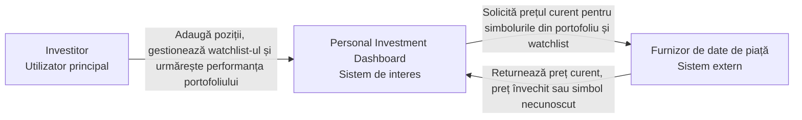

# Personal Investment Dashboard — Definirea produsului inițial

Soluție pentru Laboratorul 1, aplicând metoda din Lecția 2 (dovezi din cercetare
→ părți interesate și actori → promisiunea produsului → obiective și obiective
excluse → povești de Utilizator și definiții de Făcut → limita sistemului → C4
System Context view).

## 1. Cercetarea produsului

**Întrebare de cercetare:** Cum ajută produsele existente un Utilizator să
urmărească informații despre piață, și ce părți aparțin primei versiuni a
acestui Dashboard?

| Produs | Utilizatorul probabil și obiectivul său | Model reutilizabil |
| --- | --- | --- |
| **MarketWatch** (produs cu date de piață) | Investitor/cititor de știri financiare care vrea o singură vedere a simbolurilor urmărite alături de context de piață, fără să tranzacționeze din produs | Watchlist-uri personalizate, multiple, sincronizate pe toate dispozitivele, alături de cotații și date de piață actualizate în timp real; produsul e centrat pe informare (știri, cotații, calendar economic), fără funcție de plasare a ordinelor |
| **eToro** (produs de tranzacționare) | Investitor activ care vrea să dețină poziții reale și să le tranzacționeze direct din produs, eventual copiind strategia altor investitori | Portofoliul e populat din pozițiile reale deschise de utilizator (sau copiate automat de la alt investitor), cu alocări și profit/pierdere nerealizat actualizate în timp real; produsul include execuție reală a tranzacțiilor, dincolo de simpla urmărire |

**Decizie de domeniu de aplicare confirmată de cercetare:** Dashboard-ul preia
modelul MarketWatch — watchlist-uri multiple, informative, fără execuție — și
respinge explicit modelul eToro de portofoliu populat automat prin execuție
reală sau copiere de poziții (vezi Obiectiv exclus 1).

Surse: [marketwatch.com — aplicația MarketWatch](https://play.google.com/store/apps/details?id=com.marketwatch),
[etoro.com — CopyTrader](https://www.etoro.com/copytrader/how-it-works/)

## 2. Părți interesate și actori

| Parte interesată | Motivație | Influență | Motiv |
| --- | --- | --- | --- |
| Investitorul individual | Ridicată | Ridicată | Beneficiarul direct; decide dacă adoptă și continuă să folosească produsul |
| Furnizorul de date de piață | Scăzută | Ridicată | Neafectat de Dashboard, dar poate opri sau întârzia accesul la prețuri, blocând funcția centrală |
| Brokerul/banca unde investitorul deține activele reale | Scăzută | Scăzută | Deține sursa reală a pozițiilor, dar v1 nu se conectează la el — poziții introduse manual |
| Proprietarul produsului Dashboard | Ridicată | Ridicată | Ia deciziile de domeniu de aplicare, dar nu participă la fluxul de urmărire |
| Autoritatea de reglementare a pieței de capital | Scăzută | Ridicată | Poate impune reguli privind afișarea datelor financiare, dar nu folosește direct produsul |

**Matrice motivație/influență**

| Motivație | Influență scăzută | Influență ridicată |
| --- | --- | --- |
| **Ridicată** | — | Investitorul individual; Proprietarul produsului |
| **Scăzută** | Brokerul/banca (v1) | Furnizorul de date de piață; Autoritatea de reglementare |

**Clasificare**

- **Actor uman direct:** Investitorul individual
- **Sistem extern conectat direct:** Furnizorul de date de piață
- **Alte părți interesate** (nu apar în System Context view): Brokerul/banca,
  Proprietarul produsului, Autoritatea de reglementare

## 3. Promisiunea și domeniul de aplicare ale produsului

> **Personal Investment Dashboard** ajută **Investitorul individual** să
> urmărească valoarea curentă și câștigul sau pierderea propriilor poziții de
> investiții introduse manual, **astfel încât** să vadă clar, într-un singur
> loc, dacă portofoliul lui crește sau scade — chiar și atunci când prețul
> unui simbol lipsește sau este învechit.

**Obiective**

1. Permite Investitorului să adauge o poziție (simbol, cantitate, preț de
   achiziție) în portofoliul propriu.
2. Arată valoarea curentă și câștigul/pierderea (zilnică și totală) pentru
   fiecare poziție deținută.
3. Arată valoarea totală a portofoliului și câștigul/pierderea agregată,
   semnalând explicit când o poziție lipsă din calcul face totalul incomplet.
4. Permite Investitorului să urmărească simboluri într-un watchlist separat de
   portofoliu, fără să dețină acele poziții.
5. Arată portofoliul și watchlist-ul doar Investitorului care le deține,
   respingând orice acces sau modificare neautorizată.

**Obiective excluse**

1. Executarea reală a ordinelor de cumpărare/vânzare, copierea automată a
   pozițiilor altor investitori sau conectarea directă la un cont de
   broker/tranzacționare (portofoliul rămâne introdus manual, ca la
   MarketWatch, nu populat automat prin execuție sau copy-trading ca la
   eToro).
2. Recomandări de investiții, analiză tehnică avansată, alerte de preț
   personalizate sau flux de știri financiare.
3. Partajarea portofoliului cu alți Investitori, consilieri financiari sau
   orice funcție colaborativă/socială.

## 4. Cerințe funcționale

**DASH-1**

Obiectivul actorului: Investitorul trebuie să înregistreze o poziție pe care o
deține deja, astfel încât Dashboard-ul să o includă în calculele viitoare.

Povestea de Utilizator: Ca Investitor, vreau să adaug o poziție (simbol,
cantitate, preț de achiziție) în portofoliul meu, astfel încât să pot urmări
acea investiție de acum înainte.

Definițiile de Făcut:
- Arată poziția nouă în portofoliu imediat după salvare, cu simbolul,
  cantitatea și prețul de achiziție introduse.
- Dacă simbolul nu este recunoscut de furnizorul de date de piață, arată o
  eroare clară și nu salva poziția.
- Dacă cantitatea sau prețul introdus nu este un număr valid, arată o eroare
  clară și nu salva poziția.

**DASH-2**

Obiectivul actorului: Investitorul trebuie să afle cât valorează acum o
poziție deținută și cât a câștigat sau pierdut din ea.

Povestea de Utilizator: Ca Investitor, vreau să văd valoarea curentă și
câștigul sau pierderea fiecărei poziții deținute, astfel încât să știu cum
evoluează fiecare investiție.

Definițiile de Făcut:
- Arată prețul curent, valoarea poziției și câștigul/pierderea zilnică și
  totală, calculate din prețul curent al simbolului.
- Dacă prețul curent al simbolului lipsește sau este învechit, arată starea
  „preț indisponibil” sau „preț învechit” lângă poziție și nu calcula un
  câștig/pierdere fals.
- Arată data/ora ultimei actualizări a prețului lângă fiecare poziție.

**DASH-3**

Obiectivul actorului: Investitorul trebuie să afle rapid starea generală a
portofoliului său, fără să adune manual fiecare poziție.

Povestea de Utilizator: Ca Investitor, vreau să văd valoarea totală a
portofoliului și câștigul/pierderea agregată, astfel încât să știu rapid dacă
portofoliul meu crește sau scade per ansamblu.

Definițiile de Făcut:
- Arată suma valorilor curente ale tuturor pozițiilor și câștigul/pierderea
  agregată zilnică și totală.
- Dacă prețul pentru cel puțin o poziție lipsește sau este învechit, arată
  totalul ca incomplet și indică explicit ce poziții nu sunt incluse, în loc
  de un total fals afișat ca fiind complet.

**DASH-4**

Obiectivul actorului: Investitorul trebuie să urmărească prețul unui simbol
pe care nu îl deține, pentru a decide ulterior dacă îl cumpără.

Povestea de Utilizator: Ca Investitor, vreau să adaug un simbol într-un
watchlist separat de portofoliul meu, astfel încât să-i urmăresc prețul fără
să dețin acea poziție.

Definițiile de Făcut:
- Arată simbolul în watchlist cu prețul lui curent, separat vizual de
  portofoliu.
- Dacă simbolul nu este recunoscut de furnizorul de date de piață, arată o
  eroare clară și nu adăuga simbolul.
- Permite eliminarea unui simbol din watchlist; simbolul nu mai apare după
  eliminare.

**DASH-5**

Obiectivul actorului: Investitorul trebuie să aibă siguranța că portofoliul
lui nu poate fi văzut sau modificat de altcineva.

Povestea de Utilizator: Ca Investitor, vreau ca doar eu să pot vedea și
modifica propriul portofoliu, astfel încât datele mele financiare să rămână
private.

Definițiile de Făcut:
- Arată portofoliul și watchlist-ul numai Investitorului autentificat care le
  deține.
- Dacă cineva încearcă să acceseze portofoliul altui Investitor, arată un
  rezultat „neautorizat” și nu arăta nicio poziție.
- Respinge orice încercare de a modifica o poziție care nu aparține
  Investitorului autentificat curent.

## 5. C4 System Context view

Verificare sistem extern (Furnizor de date de piață):

- **Responsabilitate care are nevoie de el:** calcularea valorii curente și a
  câștigului/pierderii per poziție și per portofoliu agregat (DASH-2,
  DASH-3).
- **Rezultat furnizat:** prețul curent al unui simbol.
- **Ce vede Investitorul la eșec:** poziția arată „preț indisponibil”/„preț
  învechit”, iar totalul portofoliului arată ca incomplet, cu pozițiile
  afectate marcate explicit — niciodată un rezultat inventat.
