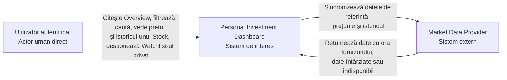
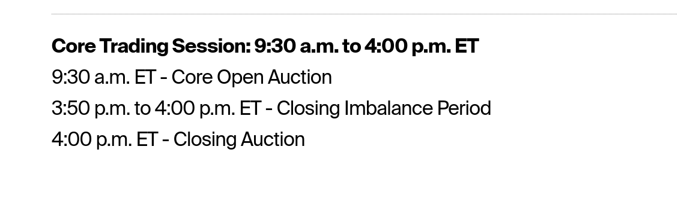
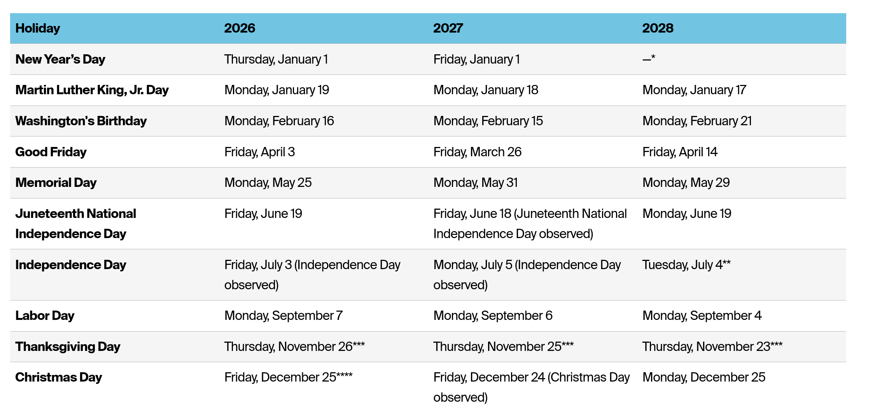
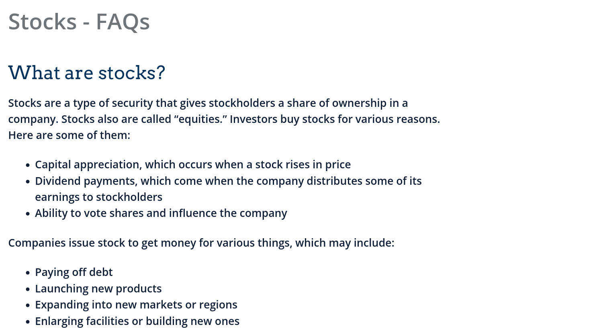
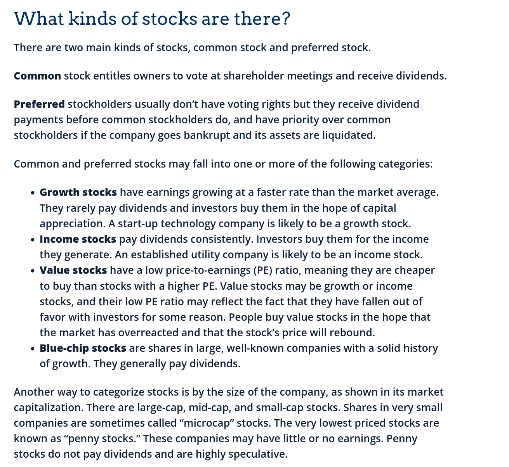
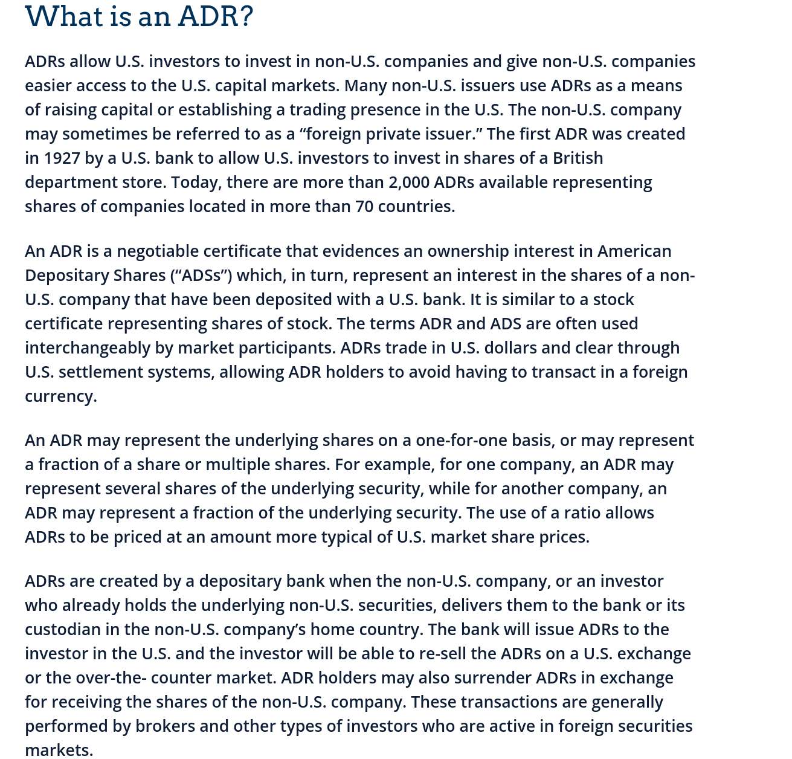

# Personal Investment Dashboard — Cuantificarea citirilor


```text
poveste de Utilizator și System Context
  -> țintă de calitate măsurabilă
  -> defectare importantă
  -> rezultat vizibil
  -> estimarea volumului de lucru
  -> presiune asupra proiectării
```


## 0. Legătura cu Laboratorul 1

În Laboratorul 1 am avut un singur actor uman direct (Investitorul) și un
singur sistem extern (Furnizorul de date de piață). În acest laborator folosesc
denumirile din enunț:

| Laboratorul 1 | Laboratorul 2 |
| --- | --- |
| Investitorul individual | Utilizatorul autentificat |
| Furnizorul de date de piață | Market Data Provider |
| DASH-4 (watchlist separat) | citirea Watchlist și modificarea Watchlist |
| DASH-5 (acces doar la propriile date) | un Utilizator nu poate citi/modifica Watchlist-ul altuia |
| DASH-2 (preț lipsă sau învechit afișat explicit) | regula de consistență pentru Stock price |

În Laboratorul 1 am pus accent și pe portofoliul introdus manual (DASH-1 –
DASH-3). Setul de citiri analizat aici este cel comun din enunț (Overview,
Filter, Stock price, History, Watchlist, Search), așa că nu estimez separat
citirile de portofoliu. Regula de bază din DASH-2 rămâne însă aceeași: un preț
lipsă este „indisponibil”, nu zero, iar un preț vechi nu e prezentat ca fiind
curent.

System Context view-ul rămâne cel din Laboratorul 1, doar cu denumirile
actualizate:



## 1. Cerințe de calitate

Forma folosită pentru fiecare cerință:

```text
În <condiția de funcționare>, <măsura> trebuie să respecte <ținta>.
```

### 1.1 Latența citirilor

**Ce măsor.** Clientul vorbește despre ce „pare” Utilizatorului, deci ținta
principală este latența **observată de Client**:

- **început:** momentul în care browserul Utilizatorului trimite cererea
  (click, reîmprospătare automată, tastare în Search);
- **sfârșit:** momentul în care rezultatul corect este utilizabil pe ecran
  (prețul cu ora furnizorului, lista filtrată, graficul de istoric etc.).

Separat, măsor și latența **în interiorul sistemului** (de la primirea cererii
de către Dashboard până la trimiterea răspunsului), ca să pot vedea cât din
timp este rețea și browser și cât este munca Dashboard-ului.

**Percentila pentru „majoritatea”.** Am ales **p95**: 95 din 100 de citiri
corecte trebuie să fie în limită. Media nu e suficientă, pentru că ascunde
citirile lente (exemplul A/B din Lecția 3). Pe lângă p95 urmăresc și p50,
ca să văd experiența tipică.

**Ținte per citire** (condiție: perioadele aglomerate, adică volumul țintă la
deschiderea pieței din secțiunea 3 — 103 / 1,030 / 10,296 RPS, în funcție de
nivel):

| Citire | p50 | p95 | De ce |
| --- | --- | --- | --- |
| Stock price | ≤ 200 ms | ≤ 500 ms | Clientul cere ca prețul „să pară imediat”; cererea vine o dată pe secundă, deci un răspuns de peste 1 s ar rămâne în urma următoarei cereri |
| Search | ≤ 300 ms | ≤ 1 s | Utilizatorul tastează și așteaptă sugestii; peste 1 s pare blocat |
| Overview | ≤ 500 ms | ≤ 1.5 s | Prima pagină după autentificare și cea mai reîmprospătată la deschiderea pieței |
| Filter | ≤ 500 ms | ≤ 1.5 s | Utilizatorul schimbă filtrul de 3 ori pe minut, deci compară rezultate rapid |
| Watchlist | ≤ 500 ms | ≤ 1.5 s | Lista e mică, dar conține prețuri pentru mai multe Stocks |
| History | ≤ 800 ms | ≤ 2 s | Răspunsul e mai mare (serie de puncte), iar Utilizatorul îl cere rar (o dată la 5 minute) |

Exemplu de cerință completă:

```text
În timpul deschiderii pieței, la cel mult 10,296 RPS de citire (nivelul de
30,000 de Utilizatori), măsurată de la trimiterea cererii de către browser până
când prețul corect cu ora furnizorului este vizibil, latența citirii Stock price
trebuie să fie p50 <= 200 ms și p95 <= 500 ms.
```

**Ce se întâmplă la limita de 2 secunde.** 2 s este limita superioară pentru
orice citire:

- dacă după **2 s** nu există un rezultat corect, Dashboard-ul oprește
  așteptarea și afișează explicit „Rezultat indisponibil momentan — reîncearcă”;
  nu afișează o listă parțială ca fiind completă și nu afișează un preț zero;
- o citire care se termină exact la 2.000 s cu rezultat corect respectă limita;
  una care depășește 2 s este numărată ca **indisponibilă**, nu ca citire
  corectă lentă;
- percentilele de latență se calculează **doar pe citirile cu rezultat corect**;
  citirile indisponibile se raportează separat (vezi 1.2). Un „indisponibil”
  întors rapid, în 100 ms, respectă ținta de latență, dar încalcă ținta de
  disponibilitate — de aceea le țin separat.

**Latența scrierii Watchlist** (nu e o citire, dar o folosesc la consistență):
de la trimiterea modificării (adăugare/eliminare) până la confirmarea vizibilă,
p95 ≤ 1 s, la volumul țintă de la deschiderea pieței.

### 1.2 Disponibilitate bazată pe timpul de funcționare

**Când este Dashboard-ul utilizabil.** Împart timpul în minute. Un minut este
**utilizabil** dacă sunt îndeplinite toate condițiile:

1. cel puțin 99% dintre citirile valide (Overview, Filter, Stock price, History,
   Watchlist, Search) din acel minut returnează un rezultat corect în cel mult
   2 s (rezultat corect = date în limita de vechime sau etichetate corect ca
   întârziate, conform 1.3);
2. în orele de tranzacționare, cel puțin 95% dintre Stocks active au un preț cu
   vechime ≤ 20 de minute (dacă furnizorul nu mai trimite nimic, Dashboard-ul
   „răspunde”, dar Utilizatorul nu mai poate folosi produsul pentru scopul lui);
3. un Utilizator autentificat își poate citi propriul Watchlist.

Un HTTP 200 cu „indisponibil” pentru toate prețurile **nu** face minutul
utilizabil. Minutele sunt verificate atât din traficul real, cât și dintr-un
test sintetic care rulează la fiecare minut (pentru orele fără trafic).

**Orele de tranzacționare.** Prima versiune acceptă doar burse din SUA (vezi
secțiunea 4). Sesiunea regulată NYSE/Nasdaq este **09:30–16:00 ET**, de luni
până vineri, fără sărbătorile bursiere
([NYSE — Holidays and Trading Hours](https://www.nyse.com/trade/hours-calendars)).



Pentru Dashboard definesc intervalul orelor de tranzacționare ca:

```text
zile de tranzacționare, 09:30 – 16:15 ET  = 6 h 45 min = 405 minute/zi
```

Am adăugat 15 minute după închidere pentru că prețurile vin cu o întârziere de
~15 minute: ultimele prețuri ale sesiunii ajung în Dashboard abia în jur de
16:15 ET. Tot restul timpului (seri, nopți, weekend, sărbători) este
„restul zilei”.

Notă: pentru noi, în Chișinău, 09:30 ET înseamnă de obicei 16:30 ora locală
(diferență de 7 ore). În câteva săptămâni din martie și octombrie/noiembrie
diferența devine 6 ore, pentru că SUA și Europa schimbă ora la date diferite.
De aceea voi măsura intervalul în ora ET, nu în ora locală.

**Ținte alese:**

| Interval | Țintă | Număr de '9' |
| --- | --- | --- |
| Ore de tranzacționare | **99.9%** | trei de '9' |
| Restul zilei | **99%** | doi de '9' |

**De ce ținte diferite.**

- În orele de tranzacționare prețurile se schimbă, iar deschiderea pieței este
  vârful de trafic (secțiunea 3). O întrerupere atunci afectează cei mai mulți
  Utilizatori exact când informația contează.
- În afara orelor, prețurile nu se mai schimbă. Utilizatorul poate vedea
  prețul de închidere cu eticheta de dată/oră și nu pierde nimic dacă verifică
  10 minute mai târziu. Tot atunci este fereastra naturală pentru mentenanță și
  pentru încărcarea istoricului zilnic.
- M-am gândit la 99.99% pentru orele de tranzacționare, dar bugetul ar scădea la
  ~51 de secunde pe 30 de zile. Dashboard-ul nu execută tranzacții (obiectiv
  exclus în Laboratorul 1) și folosește date întârziate 15 minute, deci câteva
  minute de indisponibilitate nu produc o pierdere financiară directă. Conform
  regulii ROI din Lecția 3, costul suplimentar nu se justifică pentru prima
  versiune.

**Bugetul de indisponibilitate pe 30 de zile.** Presupun **21 de zile de
tranzacționare** într-un interval de 30 de zile (30 zile ≈ 4.3 săptămâni × 5
zile lucrătoare ≈ 21.4, minus eventuale sărbători; în realitate variază între
~19 și 22).

Am verificat presupunerea pe calendarul NYSE: septembrie 2026 are 30 de zile și
22 de zile lucrătoare (luni–vineri), iar Labor Day (luni, 7 septembrie) este zi
fără tranzacționare, deci rămân exact **21 de zile de tranzacționare**.



```text
timp total în 30 de zile = 30 x 24 x 60 = 43,200 minute

ore de tranzacționare = 21 zile x 405 min = 8,505 minute (510,300 s)
restul zilei           = 43,200 - 8,505   = 34,695 minute (2,081,700 s)
```

```text
buget ore de tranzacționare = 510,300 s x (1 - 0.999)
                            = 510.3 s
                            ≈ 8 minute și 30 de secunde

buget restul zilei          = 2,081,700 s x (1 - 0.99)
                            = 20,817 s
                            = 5 ore, 46 de minute și 57 de secunde
```

Cele două intervale se măsoară și se raportează **separat**: 5 ore de
indisponibilitate într-o sâmbătă nu „compensează” și nu „consumă” bugetul
orelor de tranzacționare.

Ca măsură secundară pentru deschiderea pieței (unde traficul e concentrat),
urmăresc și disponibilitatea bazată pe încercări: în primele 10 minute după
09:30 ET, cel puțin 99.9% dintre citirile valide trebuie să primească un
rezultat corect în ≤ 2 s. Nu o folosesc în locul timpului de funcționare, doar
alături de el.

### 1.3 Consistență

#### Stock price

Vechimea unui preț = `ora curentă − ora furnizorului` pentru acel preț.
Clientul spune că întârzierea normală a furnizorului este ~15 minute, deci un
preț „vechi de 15 minute” este comportamentul normal, nu o eroare.

```text
În orele de tranzacționare, o citire Stock price returnează ultimul preț
acceptat împreună cu ora furnizorului și eticheta „Întârziat ~15 min” cât timp
vechimea prețului este <= 20 de minute.

Dacă vechimea este între 20 și 60 de minute, Dashboard-ul afișează prețul cu un
avertisment vizibil „Date întârziate — ultima actualizare HH:MM ET”.

Dacă vechimea depășește 60 de minute sau nu există niciun preț acceptat,
citirea returnează „Preț indisponibil”. Nu afișează zero și nu afișează un preț
vechi ca fiind curent.
```

- **Vechimea maximă acceptată fără avertisment: 20 de minute** (15 min
  întârzierea furnizorului + 5 min toleranță pentru sincronizarea în
  Dashboard).
- **Devine indisponibil: peste 60 de minute** sau lipsă preț.
- **În afara orelor de tranzacționare:** prețul de închidere al ultimei sesiuni
  este valid și se afișează cu eticheta „La închidere, <data>”; nu este
  considerat învechit.
- **Citiri monotone:** după ce un Utilizator a văzut un preț cu ora
  furnizorului T, citirile lui ulterioare pentru același Stock nu pot arăta un
  preț cu ora furnizorului mai veche decât T.
- Pentru partea pe care o controlează Dashboard-ul: de la momentul în care
  furnizorul livrează un preț până când acesta poate fi citit în Dashboard,
  întârzierea trebuie să fie p99 ≤ 60 s în orele de tranzacționare.

Verificare pe câteva cazuri (ca exercițiul din Lecția 3), la ora 10:40 ET:

| Ora furnizorului | Vechime | Ce se afișează | Respectă regula? |
| --- | --- | --- | --- |
| 10:25 | 15 min | preț + „Întârziat ~15 min” | Da |
| 10:10 | 30 min | preț + „Date întârziate — ultima actualizare 10:10 ET” | Da |
| 09:30 | 70 min | „Preț indisponibil” | Da |
| 09:30 | 70 min | preț fără avertisment | **Nu** — preț vechi prezentat ca actual |
| lipsă | — | `0.00 USD` | **Nu** — lipsa nu este zero |

#### Watchlist

Aici modelul potrivit este **citirea propriilor scrieri** (read-your-writes)
pentru același Utilizator:

```text
După ce Dashboard-ul confirmă o modificare a Watchlist-ului (adăugare sau
eliminare de Stock), următoarea citire a Watchlist-ului făcută de același
Utilizator trebuie să includă modificarea — Stock-ul adăugat apare, Stock-ul
eliminat nu mai apare.

Dacă Dashboard-ul nu poate garanta că lista citită include modificarea
confirmată, returnează „Watchlist indisponibil momentan”, nu lista veche
prezentată ca actuală.

Dacă modificarea nu poate fi confirmată, Dashboard-ul nu afișează succes.
```

- Nu am nevoie de consistență puternică globală: nimeni altcineva nu citește
  acest Watchlist (DASH-5), deci regula protejează doar vederea Utilizatorului
  care l-a modificat.
- Un alt Utilizator nu vede niciodată Watchlist-ul respectiv (nici după
  modificare, nici înainte).
- Prețurile din Watchlist urmează regula de la Stock price de mai sus.

### 1.4 Debit

Pe lângă cele trei calități cerute explicit, scriu și ținta de debit, pentru
că o folosesc în secțiunea 5:

```text
În primele 10 secunde după deschiderea pieței, Dashboard-ul finalizează cel
puțin 103 / 1,030 / 10,296 citiri acceptabile pe secundă (pentru 300 / 3,000 /
30,000 de Utilizatori concurenți), în timp ce țintele de latență,
disponibilitate și consistență de mai sus continuă să fie respectate.
```

O citire „acceptabilă” = rezultat corect în ≤ 2 s. Citirile care au pornit, dar
au expirat sau au returnat indisponibil nu intră în debit.

## 2. Estimări RPS în regim stabil

Formula:

```text
RPS = Utilizatori concurenți x pondere participantă x acțiuni per Utilizator / secunde
```

Ipoteze:

- fiecare acțiune a Utilizatorului = o cerere către Dashboard;
- nu presupun că o cerere către Dashboard creează o cerere către furnizor;
- procentele sunt medii în interval, iar fluxurile au loc simultan;
- reîncercările și activitatea din fundal nu sunt incluse;
- nu rotunjesc niciun rând — în regim stabil nu cer o țintă rotunjită.

Rata pe Utilizator (independentă de nivel):

| Citire | Comportament | Calcul pe 1 Utilizator | Cereri/s per Utilizator concurent |
| --- | --- | --- | --- |
| Overview | 70% o dată la 30 s | `0.70 x 1 / 30` | 0.023333… |
| Filter | 50% de 3 ori pe minut | `0.50 x 3 / 60` | 0.025 |
| Stock price | 20% o dată pe secundă | `0.20 x 1 / 1` | 0.2 |
| History | 20% o dată la 5 min | `0.20 x 1 / 300` | 0.000666… |
| Watchlist | 60% o dată pe minut | `0.60 x 1 / 60` | 0.01 |
| Search | 10% de 3 ori pe minut | `0.10 x 3 / 60` | 0.005 |
| **Total** | | | **0.264** |

Calculele pentru fiecare nivel (RPS = cereri pe secundă):

| Citire | 300 Utilizatori | 3,000 Utilizatori | 30,000 Utilizatori |
| --- | --- | --- | --- |
| Overview | `300 x 0.70 / 30` = **7** | `3,000 x 0.70 / 30` = **70** | `30,000 x 0.70 / 30` = **700** |
| Filter | `300 x 0.50 x 3 / 60` = **7.5** | `3,000 x 0.50 x 3 / 60` = **75** | `30,000 x 0.50 x 3 / 60` = **750** |
| Stock price | `300 x 0.20 x 1 / 1` = **60** | `3,000 x 0.20 x 1 / 1` = **600** | `30,000 x 0.20 x 1 / 1` = **6,000** |
| History | `300 x 0.20 / 300` = **0.2** | `3,000 x 0.20 / 300` = **2** | `30,000 x 0.20 / 300` = **20** |
| Watchlist | `300 x 0.60 / 60` = **3** | `3,000 x 0.60 / 60` = **30** | `30,000 x 0.60 / 60` = **300** |
| Search | `300 x 0.10 x 3 / 60` = **1.5** | `3,000 x 0.10 x 3 / 60` = **15** | `30,000 x 0.10 x 3 / 60` = **150** |
| **Total în regim stabil** | `7 + 7.5 + 60 + 0.2 + 3 + 1.5` = **79.2 RPS** | `70 + 75 + 600 + 2 + 30 + 15` = **792 RPS** | `700 + 750 + 6,000 + 20 + 300 + 150` = **7,920 RPS** |

Ce am observat:

- **Stock price** dă `0.2 / 0.264 ≈ 75.8%` din traficul stabil la toate
  nivelurile. Este primul flux pe care l-aș testa, dar asta nu dovedește că e
  un blocaj.
- Overview + Filter împreună sunt ~18.3%, iar History este sub 0.3%.
- Modelul este liniar: fiecare nivel este exact de 10 ori precedentul, pentru
  că am păstrat același comportament. Asta este un rezultat al modelului, nu
  o garanție că la 30,000 de Utilizatori comportamentul rămâne același.

## 3. Estimări RPS la deschiderea pieței

Comportament suplimentar la deschidere (conform clientului):

- 30% dintre Utilizatori reîmprospătează Overview o dată într-un interval de
  10 s;
- 60% din acest grup de 30% reîmprospătează și Watchlist (adică 18% din total);
- traficul stabil continuă în paralel și îl număr o singură dată; fluxurile
  de mai sus sunt **suplimentare**, nu înlocuiesc Overview/Watchlist stabil.

```text
Overview suplimentar  = Utilizatori x 0.30 / 10 s
Watchlist suplimentar = Utilizatori x 0.30 x 0.60 / 10 s
subtotal              = trafic stabil + Overview suplimentar + Watchlist suplimentar
marjă                 = subtotal x 0.10
țintă                 = (subtotal + marjă), rotunjit în sus
```

| Calcul la deschiderea pieței | 300 Utilizatori | 3,000 Utilizatori | 30,000 Utilizatori |
| --- | --- | --- | --- |
| Trafic stabil de citire | 79.2 RPS (din secțiunea 2) | 792 RPS | 7,920 RPS |
| Flux suplimentar de reîmprospătare Overview | `300 x 0.30 / 10` = 9 RPS | `3,000 x 0.30 / 10` = 90 RPS | `30,000 x 0.30 / 10` = 900 RPS |
| Flux suplimentar de reîmprospătare Watchlist | `300 x 0.30 x 0.60 / 10` = 5.4 RPS | `3,000 x 0.30 x 0.60 / 10` = 54 RPS | `30,000 x 0.30 x 0.60 / 10` = 540 RPS |
| **Subtotal la deschiderea pieței** | `79.2 + 9 + 5.4` = **93.6 RPS** | `792 + 90 + 54` = **936 RPS** | `7,920 + 900 + 540` = **9,360 RPS** |
| Marjă de capacitate de 10% | `93.6 x 0.10` = 9.36 RPS | `936 x 0.10` = 93.6 RPS | `9,360 x 0.10` = 936 RPS |
| **Țintă rotunjită în sus la deschiderea pieței** | `93.6 + 9.36 = 102.96` → **103 RPS** | `936 + 93.6 = 1,029.6` → **1,030 RPS** | `9,360 + 936 = 10,296` → **10,296 RPS** |

Pentru 30,000 de Utilizatori rezultatul este deja un număr întreg, deci
rotunjirea nu îl schimbă.

Deschiderea pieței crește traficul cu `(0.03 + 0.018) / 0.264 ≈ 18.2%` față de
regimul stabil (înainte de marjă). Pentru Overview creșterea este mare
(700 → 1,600 RPS la 30,000 de Utilizatori, adică de ~2.3 ori), iar pentru
Watchlist la fel (300 → 840 RPS, de 2.8 ori). Chiar dacă Stock price rămâne cel
mai mare flux în total, Overview și Watchlist sunt cele care „sar” la 09:30.

Marja de 10% dă spațiu peste estimare, dar nu acoperă o ipoteză greșită (de
exemplu, dacă la deschidere 60% și nu 30% reîmprospătează Overview).

## 4. Estimări de stocare

### 4.1 Ce înseamnă „Stock” pentru acest Dashboard

**Cercetare.** În produsele cu date de piață, „stock” poate însemna mai multe
lucruri. Am analizat fișierele publice de simboluri Nasdaq Trader
([nasdaqlisted.txt](https://www.nasdaqtrader.com/dynamic/SymDir/nasdaqlisted.txt),
[otherlisted.txt](https://www.nasdaqtrader.com/dynamic/SymDir/otherlisted.txt),
[definițiile câmpurilor](https://www.nasdaqtrader.com/trader.aspx?id=symboldirdefs))
și am văzut că pe aceeași listă stau împreună: acțiuni comune (common stock /
ordinary shares), ADR-uri, acțiuni preferențiale, warrants, rights, units ale
SPAC-urilor, obligațiuni (notes), fonduri închise și ETF-uri. Toate au simbol
și preț, dar nu toate sunt „acțiuni” în sensul pe care îl așteaptă un
investitor individual.

Definiții folosite:

- **Stock (common stock):** o acțiune reprezintă o parte din proprietatea unei
  companii; deținătorii de acțiuni comune au de regulă drept de vot și pot
  primi dividende
  ([Investor.gov — Stocks](https://www.investor.gov/introduction-investing/investing-basics/investment-products/stocks)).
  Aceeași pagină spune că există două tipuri principale, common și preferred;
  de aici am luat decizia să includ doar common stock (preferred are alte
  reguli pentru dividende și de obicei nu are drept de vot).
- **ADR (American Depositary Receipt):** un titlu tranzacționat în SUA care
  reprezintă acțiuni ale unei companii din afara SUA, deținute de o bancă
  depozitară
  ([Investor.gov — Investor Bulletin: American Depositary Receipts](https://www.investor.gov/introduction-investing/general-resources/news-alerts/alerts-bulletins/investor-bulletins-88)).
  Buletinul precizează că ADR-urile se tranzacționează în dolari SUA, deci se
  potrivesc cu decizia de a avea o singură monedă. Tot acolo scrie că există
  peste 2,000 de ADR-uri, dar pe cele trei burse alese am găsit doar 292 —
  restul se tranzacționează OTC, pe care nu îl accept.







**Definiția pentru Dashboard:**

> Un **Stock** este o acțiune comună (inclusiv clase diferite ale aceleiași
> companii, de ex. Class A / Class B) sau un ADR, listat pe o bursă din SUA
> acceptată, care are un simbol unic și un preț publicat de Market Data
> Provider în USD.

**Decizii despre produs:**

| Decizie | Alegerea mea | Motiv |
| --- | --- | --- |
| Țări / burse | Doar SUA: **NYSE, Nasdaq, NYSE American** | O singură monedă (USD), un singur calendar de tranzacționare și un singur fus orar pentru „orele de tranzacționare” din 1.2. Aceste burse au cele mai multe companii urmărite de investitorii individuali. NYSE Arca și Cboe BZX le-am exclus pentru că, din fișiere, acolo sunt aproape numai ETF-uri |
| Incluse | Common stock (toate clasele) și ADR-uri | Asta caută un Utilizator când spune „acțiunea Apple” sau „acțiunea Alibaba” |
| Excluse | Preferred stock, ETF-uri, fonduri (inclusiv închise), warrants, rights, units, notes, OTC | Au altă logică de preț/risc sau altă semnificație (un ETF e un fond, nu o companie). ETF-urile sunt populare, dar le las pentru o versiune următoare ca să țin „Stock” clar definit. Filter și Search ar deveni ambigue dacă amestec tipurile |
| Instrumente inactive / delistate | **Nu** apar în Search, Filter sau Overview. Rămân păstrate ca înregistrare inactivă, cu istoricul zilnic, încă 1 an după delistare | Dacă un Stock din Watchlist-ul cuiva este delistat, Utilizatorul vede „Stock delistat la <data>” și ultimul preț, în loc ca simbolul să dispară fără explicație (legat de DASH-2 din Laboratorul 1) |
| Număr de Stocks | **5,612 observate → 6,000 folosit ca valoare de planificare** | vezi mai jos |

**Numărarea.** Am descărcat cele două fișiere Nasdaq Trader pe **30.09.2026**
(ora de generare din fișier: `File Creation Time: 0930202603:03`) și le-am
filtrat cu scriptul [`lab2_calc.py`](./lab2_calc.py) (secțiunea 1 din
script; fără pachete externe, se rulează cu `python3 lab2_calc.py`):

- am eliminat `Test Issue = Y` și `ETF = Y`;
- am păstrat doar Nasdaq (`nasdaqlisted.txt`) și bursele `N` (NYSE) și `A`
  (NYSE American) din `otherlisted.txt`;
- am păstrat denumirile care conțin „Common Stock”, „Ordinary Shares”,
  „Common Shares”, „Class A/B/C” sau „American Depositary”, și am eliminat
  cele care conțin „Warrant”, „Right”, „Unit”, „Preferred”, „Notes due” sau „%”.

Rezultat observat la 30.09.2026:

| Bursă | Common stock | ADR |
| --- | --- | --- |
| Nasdaq | 3,163 | 174 |
| NYSE | 1,907 | 112 |
| NYSE American | 250 | 6 |
| **Total** | **5,320** | **292** |

Total: **5,612** Stocks. Filtrul după nume nu este perfect — am văzut
companii fără „Common Stock” în denumire, de ex. „Novagold Resources Inc.” —
așa că folosesc **6,000 de Stocks** ca valoare de planificare (~6–7% peste
numărul observat, care acoperă și listările noi din primul an).

Tot din aceste fișiere am măsurat lungimile medii folosite la estimarea
octeților: simbolul are în medie 3.6 caractere (maxim 6), numele companiei ~24
de caractere, iar denumirea completă a titlului ~42 de caractere.

### 4.2 Datele sincronizate

Stochez doar ce folosesc fluxurile din Laboratorul 1. Nu copiez tot ce oferă
furnizorul.

| Set de date | Câmpuri stocate | Nevoia de produs | Sincronizare (presupunere) |
| --- | --- | --- | --- |
| Date de referință Stock | id, simbol, nume companie, nume normalizat pentru căutare, denumirea titlului, bursă, tip (common/ADR), monedă, țară, sector, industrie, capitalizare, stare (activ/inactiv), dată listare/delistare, ultima actualizare | **Search** (simbol, nume), **Filter** (bursă, sector, industrie, capitalizare, tip), **Stock detail** (nume, bursă), Watchlist delistat | o dată pe zi, în afara orelor de tranzacționare |
| Cele mai recente prețuri | id Stock, ultimul preț, închiderea anterioară, open/high/low al zilei, volum, **ora furnizorului**, ora primirii în Dashboard, stare | **Stock price**, **Overview**, **Watchlist**, regula de vechime din 1.3 (ora furnizorului + ora primirii) | continuă în orele de tranzacționare; o valoare per Stock, suprascrisă |
| Price history — intraday | bare de **5 minute** OHLCV (open, high, low, close, volum), **păstrate 30 de zile calendaristice (~21 zile de tranzacționare)** | graficele **History** pentru 1 zi, 1 săptămână, 1 lună | la fiecare 5 minute în sesiune |
| Price history — zilnic | bare **zilnice** OHLCV + close ajustat, **păstrate 5 ani** (backfill inițial) + creștere continuă | graficele **History** pentru 3 luni, 1 an, 5 ani; prețul de închidere afișat în afara orelor | o dată pe zi după închidere |
| Alte date selectate | **calendarul bursier** (zile de tranzacționare, sărbători, închideri devreme) și **evenimentele de split** | calendarul definește „orele de tranzacționare” și eticheta „La închidere” (1.2, 1.3); split-urile sunt necesare ca istoricul să nu arate o „prăbușire” falsă de preț | calendar: o dată pe lună; split-uri: zilnic |

Nu stochez: știri, date fundamentale detaliate, dividende, tick-uri individuale
(fiecare tranzacție), cotații bid/ask (level 2). Nu sunt cerute de niciun flux
din Laboratorul 1 (știrile și analiza sunt chiar obiective excluse).

Datele Watchlist sunt date ale Utilizatorului, nu date de piață, așa că nu le
includ în această estimare.

### 4.3 Înregistrări reprezentative și octeți per înregistrare

Estimez stocarea brută (octeții câmpurilor), fără indexuri, replici, jurnale
sau copii de siguranță.

**Stock de referință** — exemplu:

```text
id=1042 | symbol=AAPL | name=Apple Inc. | name_search=apple inc |
security=Apple Inc. - Common Stock | exchange=Q | type=COMMON | currency=USD |
country=US | sector=45 | industry=4520 | market_cap=3.4e12 | status=ACTIVE |
listed=1980-12-12 | delisted=null | updated_at=2026-09-30T02:00:00Z
```

| Câmp | Octeți |
| --- | --- |
| id | 8 |
| simbol (max 6 caractere) | 6 |
| nume companie (medie măsurată ~24) | 25 |
| nume normalizat pentru Search | 25 |
| denumirea titlului (medie măsurată ~42) | 42 |
| bursă, tip | 1 + 1 |
| monedă, țară | 3 + 2 |
| cod sector, cod industrie | 2 + 2 |
| capitalizare | 8 |
| stare | 1 |
| dată listare, dată delistare | 4 + 4 |
| ultima actualizare | 8 |
| **Total** | **142 → ~160 B** (cu prefixe de lungime pentru textele variabile) |

**Cel mai recent preț** — exemplu:

```text
stock_id=1042 | last=254.43 | prev_close=252.10 | open=252.80 | high=255.00 |
low=251.90 | volume=38,120,400 | provider_time=2026-09-30T14:25:00-04:00 |
received_at=2026-09-30T14:40:03-04:00 | status=DELAYED
```

`8 (id) + 6 x 8 (prețuri și volum) + 8 + 8 (două timestamp-uri) + 1 (stare) = 81 B`

**Bară intraday de 5 minute:** `8 (id) + 8 (început bară) + 4 x 8 (OHLC) + 8 (volum) = 56 B`

**Bară zilnică:** `8 (id) + 4 (dată) + 4 x 8 (OHLC) + 8 (close ajustat) + 8 (volum) = 60 B`

**Zi din calendar:** `4 (dată) + 8 (deschidere) + 8 (închidere) + 1 (tip zi) = 21 → 24 B`

**Split:** `8 (id) + 4 (dată) + 4 + 4 (raport) + 8 (primit la) = 28 → 32 B`

### 4.4 Calculul stocării

```text
raw storage = record count x average bytes per record

history record count
  = supported Stocks x history points per Stock per day x retained days
```

Presupuneri:

- 6,000 de Stocks acceptate;
- sesiunea regulată = 390 de minute → `390 / 5 = 78` de bare de 5 minute pe zi;
- 30 de zile calendaristice ≈ 21 de zile de tranzacționare;
- 5 ani ≈ `5 x 252 = 1,260` de zile de tranzacționare;
- ~550 de split-uri pe an: StockAnalysis listează **530** de split-uri (forward +
  reverse) pe piața din SUA în 2025
  ([All 2025 Stock Splits](https://stockanalysis.com/actions/splits/2025/),
  consultat 30.09.2026); am rotunjit în sus la 550. Lista include și titluri
  pe care nu le accept (OTC, ETF-uri), deci pentru domeniul meu numărul real
  este probabil mai mic;
- ~730 de înregistrări noi de referință pe an (~2 pe zi calendaristică):
  StockAnalysis numără **350** de IPO-uri în SUA în 2025
  ([IPO Statistics](https://stockanalysis.com/ipos/statistics/), consultat
  30.09.2026), adică `350 / 252 ≈ 1.4` pe zi de tranzacționare. Am luat
  aproximativ dublu ca să acopăr și listările directe, spin-off-urile și
  mutările de pe OTC pe o bursă acceptată, care nu sunt IPO-uri;
- calendar pentru 5 ani în urmă + 1 an în avans = `6 x 365 = 2,190` de zile;
- conversie binară: `1 MiB = 1,048,576 B`, `1 GiB = 1,073,741,824 B`.

| Set de date | Decizia despre produs și perioada de păstrare | Calculul numărului de înregistrări | Octeți per înregistrare | Stocare brută |
| --- | --- | --- | --- | --- |
| Date de referință Stock | 6,000 Stocks active; delistatele rămân inactive 1 an | `6,000` | 160 B | `6,000 x 160` = 960,000 B ≈ **0.92 MiB** |
| Cele mai recente prețuri | un preț per Stock, suprascris | `6,000` | 81 B | `6,000 x 81` = 486,000 B ≈ **0.46 MiB** |
| Price history — intraday | bare de 5 min, 30 de zile (~21 zile de tranzacționare), fereastră glisantă | `6,000 x 78 x 21` = 9,828,000 | 56 B | 550,368,000 B ≈ **524.87 MiB** |
| Price history — zilnic | bare zilnice, backfill 5 ani (1,260 zile de tranzacționare), apoi creștere | `6,000 x 1 x 1,260` = 7,560,000 | 60 B | 453,600,000 B ≈ **432.59 MiB** |
| Alte date selectate | calendar (6 ani) + split-uri (5 ani) | `2,190` + `5 x 550 = 2,750` | 24 B / 32 B | `52,560 + 88,000` = 140,560 B ≈ **0.13 MiB** |
| **Total** | stocare inițială după backfill | | | **1,005,554,560 B ≈ 959.0 MiB ≈ 0.94 GiB** |

**Creșterea zilnică** (pe zi de tranzacționare):

```text
intraday: 6,000 x 78 x 56 = 26,208,000 B/zi ≈ 25.0 MiB scriși pe zi
          dar fereastra e glisantă: se șterge ziua cea mai veche,
          deci creșterea netă după primele 21 de zile este ~0

zilnic:   6,000 x 1 x 60  = 360,000 B/zi ≈ 0.34 MiB/zi (creștere netă)

referință + split-uri: câteva sute de octeți pe zi, neglijabil
```

**După un an:**

```text
bare zilnice:   252 zile x 360,000 B       = 90,720,000 B
referință:      ~730 înregistrări noi x 160 B = 116,800 B   (~2 listări noi/zi, vezi presupunerile)
split-uri:      550 x 32 B                  = 17,600 B
calendar:       365 x 24 B                  = 8,760 B
                                              -----------
creștere pe an                              ≈ 90,863,160 B ≈ 86.7 MiB

total după 1 an = 1,005,554,560 + 90,863,160
                = 1,096,417,720 B ≈ 1,045.6 MiB ≈ 1.02 GiB
```

Concluzie: datele de piață pentru domeniul ales sunt mici, în jur de 1 GiB
brut după primul an. Cea mai mare parte o reprezintă istoricul (intraday +
zilnic, ~99.8%), iar setul de date citit cel mai des — **cele mai recente
prețuri** — are sub 0.5 MiB. Asta sugerează că problema principală nu va fi
volumul stocat, ci frecvența cu care sunt citite și actualizate prețurile.
Estimarea nu include indexuri, replici, copii de siguranță și nici eventuala
extindere la ETF-uri sau alte burse (de ex., dacă aș include ETF-urile de pe
NYSE Arca și Nasdaq, numărul de instrumente ar crește cu peste 4,000).

## 5. Posibile blocaje

| Calitate | Posibil blocaj | Dovezi din acest laborator | Efect posibil | Ce trebuie măsurat în continuare |
| --- | --- | --- | --- | --- |
| Latență | Calea de citire **Stock price** | 75.8% din traficul stabil (60 / 600 / 6,000 RPS); ținta cea mai strictă (p95 ≤ 500 ms); cererea vine o dată pe secundă de la același Utilizator | p95 depășește 500 ms, prețul „pare blocat”, iar cererile încep să se suprapună (următoarea cerere pleacă înainte să vină răspunsul) | p50/p95 Stock price într-un test de încărcare cu rată constantă (ex. k6 constant-arrival-rate) la 600 și 6,000 RPS; separat timpul în Dashboard vs. rețea + browser |
| Consistență | Starea **celor mai recente prețuri** sincronizată de la Market Data Provider | Întârzierea normală de 15 min consumă deja 75% din limita de 20 min — rămân doar 5 min pentru sincronizare; toate citirile de preț (Stock price, Overview, Watchlist) depind de aceeași stare | o sincronizare întârziată face ca prețurile să treacă de 20 min (avertisment) sau 60 min (indisponibil); dacă există mai multe copii ale prețului, un Utilizator poate vedea un preț mai nou și apoi unul mai vechi (încalcă citirile monotone) | distribuția vechimii (`acum − ora furnizorului`) per Stock în orele de tranzacționare; întârzierea furnizor → Dashboard (p99 ≤ 60 s?); % Stocks peste 20 min; numărul de cazuri în care ora furnizorului scade între două citiri ale aceluiași Utilizator |
| Debit | **Deschiderea pieței** pe Overview + **Watchlist** | Overview crește de ~2.3 ori (700 → 1,600 RPS), Watchlist de 2.8 ori (300 → 840 RPS) la 30,000 de Utilizatori, în 10 s; ținta totală 10,296 RPS. Watchlist-ul e privat, deci răspunsul nu poate fi refolosit între Utilizatori, iar fiecare citire aduce prețuri pentru mai multe Stocks | în primele secunde după 09:30 ET, citirile acceptabile finalizate pe secundă scad sub țintă; o parte expiră la 2 s și devin „indisponibile” exact la vârf | numărul mediu și maxim de Stocks într-un Watchlist (efectul de „fan-out”: 840 citiri/s × ~10 Stocks = ~8,400 citiri de preț/s); citiri acceptabile/s într-un test cu salt brusc de trafic în 10 s; cât de concentrat e vârful în realitate (primele 10 s vs primul minut) |
| Disponibilitate | Dependența externă **Market Data Provider** | Este singurul sistem extern din System Context; minutul este „utilizabil” doar dacă ≥ 95% din Stocks au preț ≤ 20 min; bugetul în orele de tranzacționare e de doar ~8 min 30 s pe 30 de zile | o întrerupere a furnizorului de 30 de minute, în timpul sesiunii, consumă de ~3.5 ori bugetul lunar, chiar dacă Dashboard-ul în sine funcționează; Utilizatorul vede „Date întârziate”, apoi „Preț indisponibil” | istoricul de disponibilitate/SLA al furnizorului ales; durata și frecvența golurilor din fluxul de prețuri; cât durează până detectăm oprirea (MTTR); ce parte din Dashboard rămâne utilizabilă fără furnizor (Search, Filter, History, Watchlist cu prețuri etichetate) |

### Explicații pe rânduri

**1. Latență — Stock price**

1. *Presiunea:* calea de citire Stock price, cerută de 20% dintre Utilizatori
   în fiecare secundă.
2. *Cum încalcă ținta:* dacă fiecare citire face aceeași muncă (găsirea
   Stock-ului, citirea prețului, formatarea etichetei de întârziere) pentru
   mulți Utilizatori care cer același Stock, timpul de răspuns crește odată
   cu traficul și p95 trece de 500 ms.
3. *Dovezi:* 75.8% din traficul stabil; cea mai strictă țintă de latență;
   datele citite sunt foarte mici (486,000 B pentru toate prețurile), deci
   aceeași informație este citită de foarte multe ori.
4. *Confirmare/respingere:* test de încărcare la 6,000 RPS doar pe Stock price
   și apoi la 10,296 RPS mixt; dacă p95 rămâne sub 500 ms, ipoteza este
   respinsă pentru acest nivel.

**2. Consistență — sincronizarea prețurilor**

1. *Presiunea:* calea stării „cel mai recent preț”, scrisă de sincronizarea
   cu furnizorul și citită de trei fluxuri diferite.
2. *Cum încalcă ținta:* dacă sincronizarea rămâne în urmă mai mult de 5 minute,
   prețurile ies din limita de 20 min; dacă fluxuri diferite citesc stări
   actualizate la momente diferite, Overview și Stock detail pot arăta prețuri
   diferite pentru același Stock sau un preț poate „merge înapoi”.
3. *Dovezi:* toleranța de doar 5 minute peste întârzierea furnizorului;
   6,000 de prețuri actualizate continuu în sesiune.
4. *Confirmare/respingere:* monitorizarea vechimii per Stock pe mai multe
   sesiuni reale și un test în care sincronizarea este oprită intenționat
   5–10 minute, ca să verific că etichetele „întârziat”/„indisponibil” apar
   corect.

**3. Debit — deschiderea pieței**

1. *Presiunea:* căile de citire Overview și Watchlist, care cresc brusc în
   aceleași 10 secunde.
2. *Cum încalcă ținta:* cererile se adună mai repede decât sunt finalizate,
   unele expiră la 2 s, iar citirile acceptabile/s scad sub 10,296.
3. *Dovezi:* +1,440 RPS suplimentari la 30,000 de Utilizatori, concentrați în
   10 s; Watchlist-ul e per Utilizator și conține mai multe prețuri.
4. *Confirmare/respingere:* test cu salt de la 7,920 la 10,296 RPS în câteva
   secunde; măsor citirile acceptabile finalizate/s, nu cererile pornite.

**4. Disponibilitate — Market Data Provider**

1. *Presiunea:* dependența externă de la care vin toate prețurile.
2. *Cum încalcă ținta:* dacă furnizorul se oprește în timpul sesiunii, după
   20–60 de minute prețurile devin întârziate/indisponibile și minutele nu mai
   sunt „utilizabile” conform definiției din 1.2.
3. *Dovezi:* un singur sistem extern în System Context; buget de 8 min 30 s în
   orele de tranzacționare.
4. *Confirmare/respingere:* datele istorice de disponibilitate ale
   furnizorului și un test în care simulez lipsa lui, ca să văd ce funcții
   rămân utilizabile.

Concluzie în forma din Lecția 3:

```text
Market Data Provider este un punct de presiune potențial pentru disponibilitate
și consistență, din cauza faptului că toate prețurile vin de la el și avem doar
5 minute de toleranță peste întârzierea normală. Următoarea proiectare trebuie
să permită Dashboard-ului să continue să servească date etichetate corect când
furnizorul întârzie. Mai avem nevoie de istoricul de disponibilitate al
furnizorului și de distribuția reală a vechimii prețurilor înainte să alegem un
mecanism.
```

Toate calculele din secțiunile 1–4 (numărul de Stocks, RPS, stocarea) pot fi
refăcute cu [`lab2_calc.py`](./lab2_calc.py). Scriptul descarcă din nou
fișierele Nasdaq Trader, așa că la altă dată numărul de Stocks poate diferi cu
câteva unități; cu `--offline` folosește fișierele deja salvate.


**Ce a confirmat sau schimbat cercetarea:** numărătoarea din fișierele Nasdaq
Trader m-a făcut să exclud NYSE Arca și Cboe BZX (acolo sunt aproape doar
ETF-uri) și să păstrez ETF-urile în afara primei versiuni. Fără filtrare, lista
„tuturor simbolurilor” ar fi fost de peste 13,000 de rânduri, adică mai mult
decât dublu față de cele ~5,600 de Stocks care corespund definiției alese.

## Listă de verificare

- [x] Am scris cerințe măsurabile pentru toate calitățile de bază.
- [x] Am ales și am justificat ținte ale timpului de funcționare pentru ambele
      părți ale zilei.
- [x] Am arătat calculele RPS în regim stabil și la deschiderea pieței pentru
      toate cele trei niveluri.
- [x] Am cercetat și am definit domeniul de aplicare pentru Stocks acceptate.
- [x] Am estimat stocarea brută inițială, zilnică și pentru un an a datelor despre
      piață.
- [x] Am precizat presupunerile, unitățile, intervalele și rotunjirea finală.
- [x] Am analizat un posibil blocaj pentru fiecare calitate de bază.
