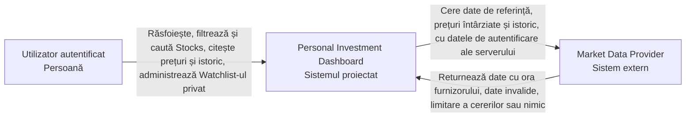
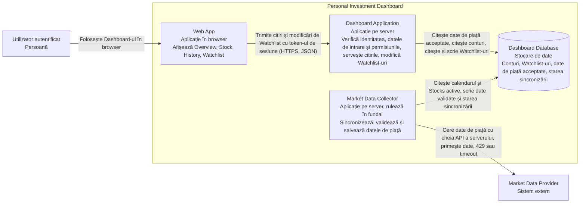
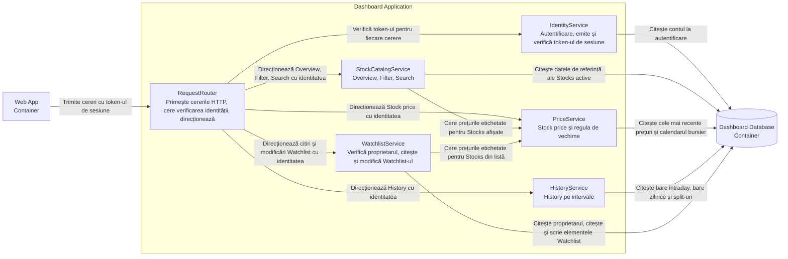
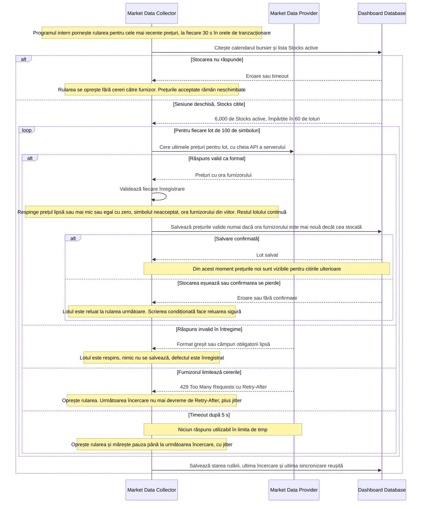
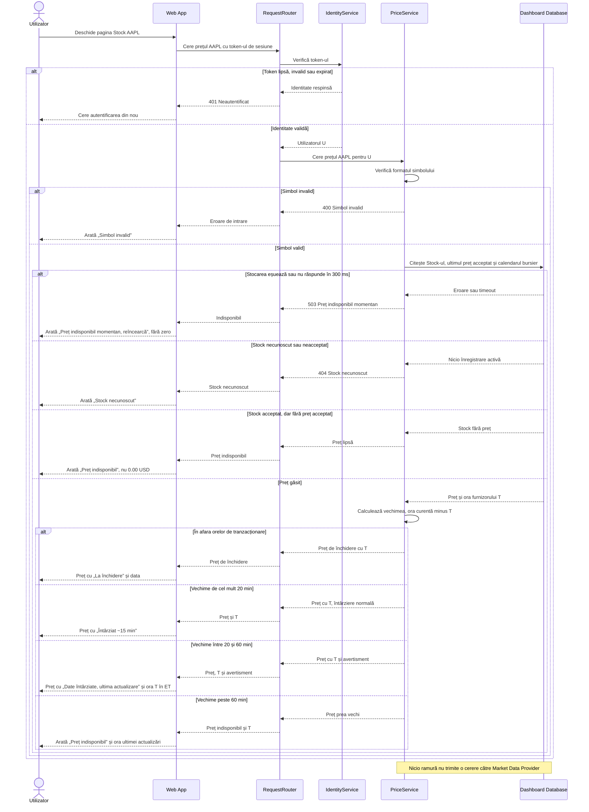
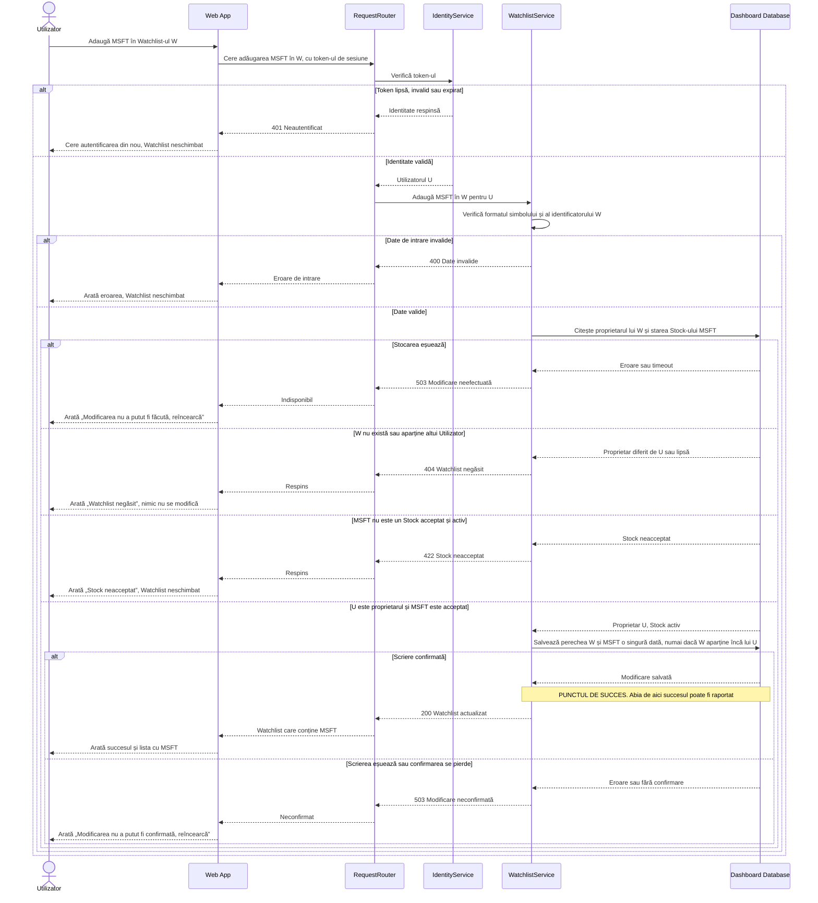

# Personal Investment Dashboard — Limita Dashboard-ului

Soluție pentru Laboratorul 3, aplicând metoda din Lecția 4:

```text
Cerințe și presiune asupra proiectării (Laboratoarele 1 și 2)
  -> System Context: sistemul și sistemele din jurul său
  -> Container: aplicații și stocări de date
  -> Component: responsabilități în interiorul Dashboard Application
  -> Fluxuri: rezultate normale, acțiuni respinse și defectări
```

## 0. Ce preiau din Laboratorul 2

Proiectarea trebuie să răspundă acestor ținte și presiuni. Le numerotez ca să
le pot referi mai jos.

| Nr. | Din Laboratorul 2 | Ce cere de la proiectare |
| --- | --- | --- |
| P1 | Stock price: p95 ≤ 500 ms, 6,000 RPS la 30,000 de Utilizatori, 75.8% din trafic | Citirea prețului nu poate aștepta după furnizor; citește doar date deja stocate |
| P2 | Vechime ≤ 20 min fără avertisment, 20–60 min cu avertisment, peste 60 min „Preț indisponibil”; furnizor → citibil p99 ≤ 60 s | Sincronizare continuă în fundal, cu ora furnizorului păstrată separat de ora primirii |
| P3 | Citiri monotone pentru Stock price | Un preț mai vechi nu poate suprascrie unul mai nou |
| P4 | Watchlist: read-your-writes, privat (DASH-5) | Verificare de identitate și de proprietar înainte de orice citire/modificare; succes raportat doar după scrierea confirmată |
| P5 | Market Data Provider: singurul sistem extern, buget de ~8 min 30 s în orele de tranzacționare | O oprire a furnizorului nu trebuie să oprească citirile; datele acceptate rămân și sunt etichetate după vechime |
| P6 | Date de piață ~1 GiB după un an; ~6,000 de Stocks | O singură stocare este suficientă ca volum; problema e frecvența citirilor, nu mărimea |

## 1. Diagrama System Context



- **Utilizator autentificat:** singurul actor uman direct (Investitorul din
  Laboratorul 1).
- **Market Data Provider:** singurul sistem extern. Nu îl controlăm; el decide
  întârzierea (~15 min), limitele de cereri și când este indisponibil.
- Brokerul, Proprietarul produsului și Autoritatea de reglementare sunt părți
  interesate, dar nu comunică direct cu sistemul, deci nu apar aici
  (Laboratorul 1, secțiunea 2).
- Autentificarea este făcută de Dashboard; în prima versiune nu folosesc un
  furnizor extern de identitate, deci nu apare ca sistem extern.

## 2. Diagrama Container



| Container | Responsabilitate | De ce există |
| --- | --- | --- |
| **Web App** | Interfața din browser: afișează rezultatele și etichetele de vechime, trimite cererile, nu păstrează nicio cheie a furnizorului | Utilizatorul are nevoie de o interfață; codul din browser nu e de încredere, deci toate verificările se repetă pe server |
| **Dashboard Application** | Singurul punct de intrare pentru Web App: verifică identitatea, datele de intrare și permisiunea; servește Overview, Filter, Search, Stock price, History și Watchlist din datele stocate; aplică regula de vechime; modifică Watchlist-uri | Ține regulile de acces (DASH-5) și regulile de consistență (P2–P4) pe server, într-un singur loc |
| **Market Data Collector** | Singurul container care vorbește cu furnizorul: pornește sincronizările după un program, validează răspunsurile, salvează numai datele acceptate, respectă limitările și pauzele de reîncercare | Separă citirile Utilizatorilor de furnizor (P1, P5); ține cheia API pe server; rulează ca **o singură instanță**, deci nu se dublează cererile către furnizor când Dashboard Application are mai multe instanțe |
| **Dashboard Database** | Păstrează conturile, Watchlist-urile, datele de referință, cele mai recente prețuri, istoricul, calendarul bursier, split-urile și starea sincronizării | Este singurul loc prin care datele colectorului ajung la citiri; scrierile Watchlist și citirile lor ulterioare trec prin aceeași copie (P4) |

**De ce acesta este cel mai mic set.**

- **Fără API Gateway:** există un singur client (Web App) și o singură aplicație
  care primește cereri, deci nu am ce direcționa între aplicații.
- **Fără cache separat în acest laborator:** datele citite des (cele mai recente
  prețuri) au sub 0.5 MiB (Laboratorul 2, 4.4). Întâi vreau să măsor dacă
  Dashboard Database ține p95 ≤ 500 ms la 6,000 RPS; calea de citire intensă
  este subiectul Laboratorului 4.
- **O singură stocare, nu două:** am avea și o stocare separată pentru
  Watchlist-uri, dar datele au ~1 GiB în total (P6), iar o a doua stocare ar
  adăuga încă un caz de defectare. Datele de piață și cele ale Utilizatorilor
  rămân separate ca tabele și ca drepturi: colectorul nu are drept de scriere
  pe conturi și Watchlist-uri.
- **Colectorul este o aplicație separată, nu o componentă din Dashboard
  Application.** Dashboard Application va avea mai multe instanțe la vârful de
  10,296 RPS; dacă sincronizarea ar fi în ea, fiecare instanță ar consuma cota
  furnizorului. Colectorul rulează o singură dată, după propriul program, iar o
  cădere a lui nu oprește citirile.

**Decizia principală: citirile nu cer niciodată date de la furnizor.** Lecția 4
propune și sincronizare declanșată de cereri. Eu am ales **numai sincronizare
în fundal**, pentru că:

- toate cele ~6,000 de prețuri încap în 60 de cereri a câte 100 de simboluri,
  deci pot fi actualizate complet la fiecare 30 s (2 cereri/s către furnizor),
  indiferent câți Utilizatori sunt conectați;
- la 6,000 RPS pe Stock price, chiar și o mică parte din citiri care ar aștepta
  furnizorul ar ieși din ținta de 500 ms și ar consuma cota;
- datele sunt întârziate oricum ~15 min; o cerere nouă la furnizor nu ar aduce
  un preț mai nou decât cel sincronizat acum 30 s.

Costul: dacă colectorul se oprește, nimic nu reîmprospătează datele, iar
prețurile îmbătrânesc până devin „Preț indisponibil”. De aceea colectorul
salvează starea sincronizării (ultima încercare, ultima reușită), ca să pot
alerta înainte să treacă 20 de minute.

**Programul de sincronizare** (presupuneri pentru furnizor: cereri în lot de
până la 100 de simboluri, cel puțin 5 cereri/s permise - de verificat cu
furnizorul ales):

| Set de date | Când | Cereri pe rulare |
| --- | --- | --- |
| Cele mai recente prețuri | la fiecare 30 s, în orele de tranzacționare (09:30–16:15 ET) | 60 |
| Bare intraday de 5 min | la fiecare 5 min, în sesiune | 60 |
| Bare zilnice + prețul de închidere | o dată, după 16:15 ET | 60 |
| Date de referință + split-uri | o dată pe zi, noaptea | câteva |
| Calendar bursier | o dată pe lună | 1 |

Cel mult o rulare activă per set de date: dacă o rulare nu s-a terminat când
vine următoarea, următoarea este sărită, nu pornită în paralel. Cele mai
recente prețuri au prioritate la cotă înaintea istoricului.

## 3. Diagrama Component — Dashboard Application



| Componentă | Responsabilitate | Verificări pe care le face |
| --- | --- | --- |
| **RequestRouter** | Punctul de intrare HTTP; trimite token-ul la IdentityService și cererea, cu identitatea, componentei potrivite | Respinge cu 401 orice cerere fără identitate validă, înainte să ajungă la date |
| **IdentityService** | Autentifică Utilizatorul (cont din Dashboard Database), emite un token de sesiune semnat și cu termen de expirare, verifică token-ul la fiecare cerere | Semnătura și expirarea token-ului se verifică local, fără citire din stocare la fiecare cerere (6,000+ RPS) |
| **StockCatalogService** | Overview, Filter și Search peste datele de referință ale Stocks active | Valorile filtrului (bursă, sector, tip) și textul de căutare (lungime, caractere) |
| **PriceService** | Citește ultimul preț acceptat și aplică regula de vechime din Laboratorul 2 (1.3): „Întârziat ~15 min”, avertisment, „Preț indisponibil”, „La închidere” | Formatul simbolului; un preț lipsă nu devine zero |
| **HistoryService** | Returnează bare de 5 minute (1 zi – 1 lună) sau zilnice (3 luni – 5 ani), ajustate pentru split-uri | Simbolul și intervalul cerut |
| **WatchlistService** | Citește și modifică Watchlist-ul Utilizatorului; cere prețurile prin PriceService | Formatul datelor; **proprietarul** Watchlist-ului = Utilizatorul din token; Stock acceptat și activ |

- Toate componentele fac parte dintr-o singură aplicație. Nu sunt servicii
  separate și nu comunică prin rețea între ele.
- **Market Data Collector nu apare aici**, pentru că nu comunică direct cu
  Dashboard Application. Singura legătură dintre ele este Dashboard Database:
  colectorul scrie, componentele citesc.
- PriceService este singurul loc unde se aplică regula de vechime. Overview și
  Watchlist cer prețurile prin el, ca același Stock să aibă aceeași etichetă pe
  toate paginile.
- Verificarea permisiunii este în WatchlistService, nu în RequestRouter: un
  token valid nu înseamnă acces la orice Watchlist (Lecția 4, secțiunea 6).

## 4. Diagrame de secvență

Participanții sunt cei din view-urile de mai sus: containerele din secțiunea 2
și componentele din secțiunea 3. Săgeata continuă este o cerere, iar cea
întreruptă este un rezultat.

### A. Sincronizează datele de piață



**Ipoteze inițiale:**

- Market Data Collector rulează ca o singură instanță; o rulare nouă nu începe
  cât timp precedenta pentru același set de date este activă.
- Cheia API a furnizorului este un secret de configurare al colectorului. Nu
  ajunge niciodată în Web App, în Dashboard Application sau în Dashboard
  Database.
- Furnizorul acceptă cereri în lot de câte 100 de simboluri; timpul maxim pe
  cerere este 5 s.
- Diagrama arată cele mai recente prețuri. Barele intraday, barele zilnice și
  datele de referință urmează același traseu, doar cu alt program (secțiunea 2).

**Când sunt disponibile datele acceptate:** imediat după ce Dashboard Database
confirmă salvarea lotului. Înainte de confirmare, nimic din lot nu este vizibil.

**Validarea per înregistrare, nu per lot.** Lecția 4 respinge întregul lot
dacă o înregistrare este invalidă. Pentru prețuri am ales să resping doar
înregistrarea greșită: un singur preț invalid ar întârzia altfel 99 de prețuri
bune, iar limita de 20 de minute lasă doar 5 minute de toleranță (P2). Stock-ul
cu înregistrarea respinsă își păstrează prețul acceptat anterior. Un răspuns
care nu poate fi citit deloc este respins în întregime.

**Ce se întâmplă cu datele acceptate anterior când sincronizarea eșuează:**
rămân neschimbate. Nu sunt șterse, nu sunt înlocuite cu zero și nu primesc o
oră nouă. Pentru că PriceService calculează vechimea din **ora furnizorului**,
nu din ora preluării, prețul îmbătrânește vizibil: până la 20 min
„Întârziat ~15 min”, între 20 și 60 min avertisment, apoi „Preț indisponibil”.
Search, Filter, History și Watchlist continuă să funcționeze.

**Citiri monotone (P3):** scrierea condiționată („numai dacă ora furnizorului
este mai nouă”) împiedică un răspuns întârziat sau repetat să suprascrie un
preț mai nou. Cum toate citirile merg la aceeași Dashboard Database, un
Utilizator nu poate vedea un preț și apoi unul mai vechi pentru același Stock.

### B. Citește prețul unui Stock



**Ipoteze inițiale:**

- Utilizatorul s-a autentificat anterior și Web App are un token de sesiune.
- Web App cere prețul o dată pe secundă cât timp pagina Stock este deschisă
  (Laboratorul 2, secțiunea 2).
- Web App așteaptă cel mult 2 s. Dacă nu primește rezultat, arată
  „Rezultat indisponibil momentan, reîncearcă” și nu păstrează pe ecran un
  preț vechi ca fiind curent (Laboratorul 2, 1.1).
- Limita de 300 ms pentru stocare lasă timp pentru rețea și browser în
  ținta p95 ≤ 500 ms.

**Are nevoie citirea de o cerere nouă către furnizor? Nu.** PriceService
citește doar ultimul preț acceptat din Dashboard Database, salvat de Market
Data Collector (fluxul A). Chiar dacă prețul e prea vechi sau lipsește, citirea
nu cheamă furnizorul; Utilizatorul vede eticheta corespunzătoare. Astfel, la
6,000 RPS nu se trimite nicio cerere suplimentară către furnizor, iar o oprire
a furnizorului nu face citirile mai lente.

**Defectarea stocării nu e tratată ca preț lipsă.** Dacă Dashboard Database nu
răspunde, rezultatul este „indisponibil momentan, reîncearcă” (503), nu
„Stock necunoscut” și nu „Preț indisponibil” pentru acel Stock.

### C. Modifică un Watchlist privat



**Ipoteze inițiale:**

- Utilizatorul are deja Watchlist-ul W; crearea unui Watchlist nou și
  eliminarea unui Stock urmează același traseu de verificări.
- Ordinea verificărilor este fixă: identitate → date de intrare → permisiune →
  scriere. Nicio scriere nu are loc înainte ca toate să reușească.
- Toate citirile și scrierile Watchlist merg la aceeași copie a Dashboard
  Database (fără replici de citire în această proiectare).

**Încercarea neautorizată** apare în două forme: fără identitate validă
(401, oprită de RequestRouter) și cu identitate validă, dar pe Watchlist-ul
altcuiva. În al doilea caz răspund cu **404 „Watchlist negăsit”**, nu cu 403,
ca să nu confirm că W există și aparține altcuiva. Scrierea repetă condiția
„W aparține lui U”, așa că nici o modificare a proprietarului apărută între
citire și scriere nu permite accesul.

**Punctul de succes** este confirmarea scrierii din Dashboard Database.
Web App nu afișează succes înainte și nu adaugă MSFT în listă „optimist”.

**Ce trebuie să arate următoarea citire a aceluiași Utilizator:** lista W cu
MSFT inclus (read-your-writes, Laboratorul 2, 1.3). Este garantat pentru că
citirea merge la aceeași copie a stocării care a confirmat scrierea. Dacă acea
citire nu poate fi făcută, Utilizatorul vede „Watchlist indisponibil momentan”,
nu lista veche fără MSFT prezentată ca actuală.

**Confirmarea pierdută:** scrierea poate să fi avut loc chiar dacă
WatchlistService nu a primit confirmarea. Perechea (W, MSFT) este unică, deci o
reîncercare a Utilizatorului nu creează un dublu, iar următoarea citire arată
starea reală a listei.

## 5. Verificarea proiectării față de cerințe

| Cerință | Unde este acoperită |
| --- | --- |
| Citiri normale (Overview, Filter, Search, Stock price, History, Watchlist) | Dashboard Application, din date stocate (secțiunile 2, 3, fluxul B) |
| Date private | IdentityService pe fiecare cerere + verificarea proprietarului în WatchlistService (fluxul C) |
| Preluarea datelor de la furnizor | Doar Market Data Collector, după program, cu cheia pe server (fluxul A) |
| Date invalide de la furnizor | Respinse per înregistrare sau per lot; prețul anterior rămâne (fluxul A) |
| Furnizor lent sau care limitează cererile | Pauză cu jitter, respectarea `Retry-After`; citirile continuă cu prețuri etichetate (fluxurile A și B) |
| Defectarea stocării | Citire: 503 „indisponibil”, nu zero și nu „necunoscut” (B); modificare: fără succes raportat (C); sincronizare: lot reluat sigur (A) |
| P1–P6 din Laboratorul 2 | P1 → B; P2, P3 → A și regula din PriceService; P4 → C; P5 → separarea colectorului; P6 → o singură stocare |

**Ce rămâne de verificat (nu e dovedit de diagrame):**

- dacă o singură Dashboard Database ține 10,296 RPS la deschiderea pieței cu
  p95 ≤ 500 ms pentru Stock price (Laboratorul 4);
- limitele reale de cereri și dimensiunea maximă a lotului la furnizorul ales;
- că Dashboard Database oferă scrierile condiționate și unicitatea pe care se
  bazează fluxurile A și C;
- ce se întâmplă dacă Market Data Collector se oprește: alertă din starea
  sincronizării înainte ca prețurile să treacă de 20 de minute.

Surse folosite: [C4 model — System Context](https://c4model.com/diagrams/system-context),
[Container](https://c4model.com/diagrams/container),
[Component](https://c4model.com/diagrams/component),
[Mermaid — sequence diagrams](https://mermaid.js.org/syntax/sequenceDiagram.html),
[RFC 6585, secțiunea 4 — 429 Too Many Requests](https://datatracker.ietf.org/doc/html/rfc6585#section-4),
[OWASP Authorization Cheat Sheet](https://cheatsheetseries.owasp.org/cheatsheets/Authorization_Cheat_Sheet.html).

## Listă de verificare

- [x] Am inclus o diagramă System Context, una Container și una Component.
- [x] Am inclus cele trei diagrame de secvență cerute.
- [x] Toate cele șase blocuri Mermaid se afișează fără erori.
- [x] Diagrama Component deschide numai Dashboard Application.
- [x] Fluxurile mele arată rezultate normale, acțiuni respinse și rezultate în
      caz de defectare.
- [x] Proiectarea acoperă citirile normale, datele private, preluarea datelor de
      la furnizor și defectările.
